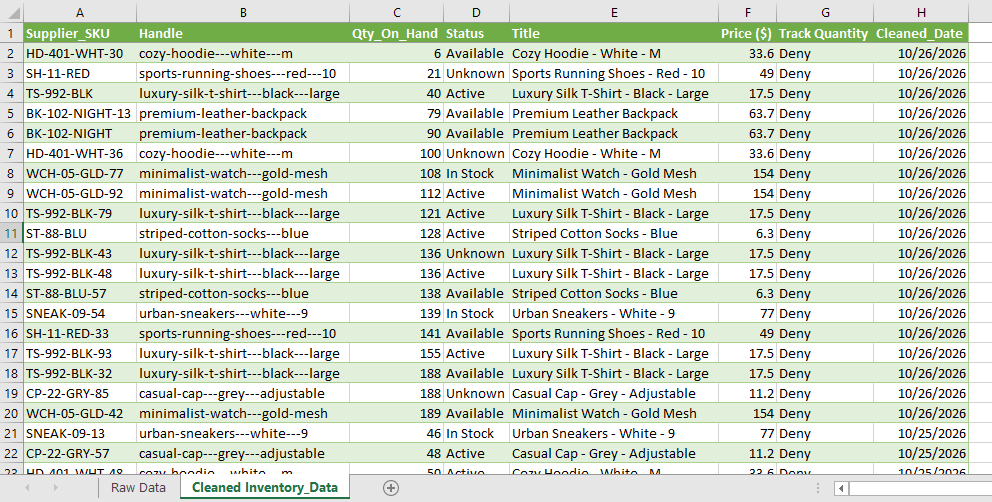
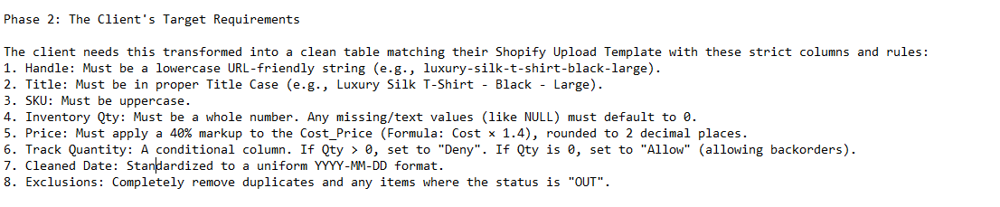
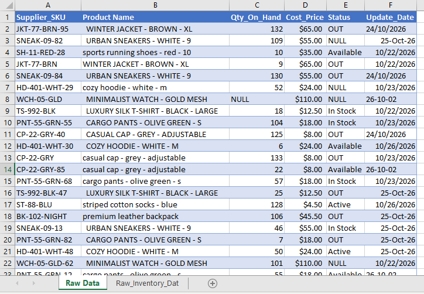
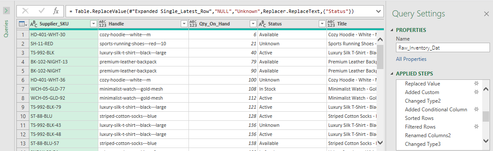

# 🛍️ Shopify Supplier Inventory ETL Pipeline
### Excel Power Query (M) — One-Click, Shopify-Ready

> **Paste messy supplier feed → Click Refresh All → Get a clean Shopify upload file.**
> No manual fixing. No overselling. No broken dates.



| | |
| :--- | :--- |
| **Client Type** | E-commerce merchant (Shopify) |
| **Problem** | Daily supplier feeds arrived messy, duplicated, and un-uploadable |
| **Solution** | Fully automated Power Query ETL pipeline |
| **Result** | 100% deduplicated, Shopify-ready catalog in 1 click |

---

## 📌 The Problem

The store team was spending hours every day manually cleaning supplier files before they could upload to Shopify:

- ❌ **4 different date formats** in one column
- ❌ **Duplicate SKUs** with conflicting stock counts
- ❌ `"NULL"` strings in Qty and Status
- ❌ Messy titles, bad handles, wrong casing
- ❌ Manual 40% markup + manual backorder flags

One mistake = wrong price, wrong stock, accidental overselling.

---

## ✅ What The Client Asked For



### 1. Shopify Catalog Formatting
- **Handle:** URL-safe, all lowercase, single hyphens → `cozy-hoodie-white-m`
- **Title:** Proper Case → `Cozy Hoodie - White - M`
- **Supplier_SKU:** Trimmed + UPPERCASE

### 2. Inventory & Pricing Logic
- `"NULL"` in `Qty_On_Hand` → `0`
- **Price ($)** = `Cost_Price × 1.4` (40% markup), rounded to 2 decimals, Currency format
- **Track Quantity** = `Deny` if `Qty > 0` (prevent backorders), `Allow` if `Qty = 0`

### 3. Smart Filtering
- Remove discontinued items where `Status = "OUT"`
- **Keep** `Status = "NULL"` → relabel as `"Unknown"` — don't accidentally delete valid products

### 4. Dates & Deduplication
- Parse **4 mixed formats** into one clean `Cleaned_Date`:
  `DD/MM/YYYY` • `DD-MMM-YY` • `MM/DD/YYYY` • `YY-MM-DD`
- Deduplicate by `Supplier_SKU` → keep **only the newest record**
- **Tie-breaker:** If two records share the same date, keep the **lower stock** to prevent overselling

---

## ⚙️ The Solution: One-Click Power Query Pipeline

**Raw Data → Power Query (M) → Cleaned_Inventory_Data → Shopify**

### What It Automates

| # | Step | What Happens |
| :--- | :--- | :--- |
| 01 | **Clean Text** | Trim, Proper Case Titles, Uppercase SKUs, URL-safe Handles |
| 02 | **Fix Stock & Status** | `"NULL"` Qty → `0`, `"NULL"` Status → `"Unknown"` |
| 03 | **Price & Backorders** | Auto 40% markup + auto `Deny / Allow` logic |
| 04 | **Parse Dates** | Custom parser handles all 4 formats, returns `null` on bad dates instead of Error |
| 05 | **Deduplicate Safely** | Sort by Newest Date → Lowest Qty, then keep 1 per SKU |

> **Why "safely"?** Most people use Remove Duplicates on SKU and delete the latest update. This pipeline does the opposite — it keeps the *latest* update, so stock is never understated.

---

## 📸 Before & After

### 1. Raw Supplier Feed — `Raw Data`
Messy dates, `"NULL"` strings, raw costs, `"OUT"` rows, duplicate SKUs.


### 2. Transformation Engine — Power Query (M)
Schema enforcement, custom date parser, conservative dedup, conditional rules.


### 3. Final Output — `Cleaned_Inventory_Data`
100% deduplicated, standardized, ready for direct Shopify CSV import.

---
---

### 🎥 Live Demo Walkthrough 
Want to see this pipeline clean messy serial dates and duplicate SKUs in real time?  
> 👉 **[Click here to watch the 90-second demo on YouTube](https://youtu.be/d1qF5V9qvsI)**

---

## 💻 Full Power Query (M) Script


<details>
<summary><b>Click to view full Power Query (M) script</b></summary>

```powerquery
let
    Source = Excel.CurrentWorkbook(){[Name="Raw_Inventory_Dat"]}[Content],
    #"Filtered Blank Rows" = Table.SelectRows(Source, each [Supplier_SKU] <> null and Text.Trim(Text.From([Supplier_SKU])) <> ""),
    #"Changed Type" = Table.TransformColumnTypes(#"Filtered Blank Rows",{{"Supplier_SKU", type text}, {"Product Name", type text}, {"Qty_On_Hand", type any}, {"Cost_Price", type number}, {"Status", type text}, {"Update_Date", type any}}),
    #"Duplicated Column" = Table.DuplicateColumn(#"Changed Type", "Product Name", "Product Name - Copy"),
    #"Renamed Columns" = Table.RenameColumns(#"Duplicated Column",{{"Product Name", "Handle"}}),
    #"Trimmed Text" = Table.TransformColumns(#"Renamed Columns",{{"Handle", Text.Trim, type text}}),
    #"Lowercased Text" = Table.TransformColumns(#"Trimmed Text",{{"Handle", each Text.Replace(Text.Replace(Text.Lower(_), " - ", "-"), " ", "-"), type text}}),
    #"Renamed Columns1" = Table.RenameColumns(#"Lowercased Text",{{"Product Name - Copy", "Title"}}),
    #"Trimmed Text1" = Table.TransformColumns(#"Renamed Columns1",{{"Title", Text.Trim, type text}}),
    #"Capitalized Each Word" = Table.TransformColumns(#"Trimmed Text1",{{"Title", Text.Proper, type text}}),
    #"Trimmed Text2" = Table.TransformColumns(#"Capitalized Each Word",{{"Supplier_SKU", Text.Trim, type text}}),
    #"Uppercased Text" = Table.TransformColumns(#"Trimmed Text2",{{"Supplier_SKU", Text.Upper, type text}}),
    #"Replaced Null Text" = Table.ReplaceValue(#"Uppercased Text","NULL",null,Replacer.ReplaceValue,{"Qty_On_Hand"}),
    #"Changed Type1" = Table.TransformColumnTypes(#"Replaced Null Text",{{"Qty_On_Hand", Int64.Type}}),
    #"Replaced Value" = Table.ReplaceValue(#"Changed Type1",null,0,Replacer.ReplaceValue,{"Qty_On_Hand"}),
    #"Added Custom" = Table.AddColumn(#"Replaced Value", "Price", each [Cost_Price]*1.4),
    #"Changed Type2" = Table.TransformColumnTypes(#"Added Custom",{{"Price", Currency.Type}}),
    #"Added Conditional Column" = Table.AddColumn(#"Changed Type2", "Track Quantity", each if [Qty_On_Hand] > 0 then "Deny" else if [Qty_On_Hand] = 0 then "Allow" else null),
    #"Sorted Rows" = Table.Sort(#"Added Conditional Column",{{"Supplier_SKU", Order.Ascending}}),
    #"Filtered Rows" = Table.SelectRows(#"Sorted Rows", each ([Status] <> "OUT")),
    #"Renamed Columns2" = Table.RenameColumns(#"Filtered Rows",{{"Cost_Price", "Cost_Price ($)"}, {"Price", "Price ($)"}}),
    #"Changed Type3" = Table.TransformColumnTypes(#"Renamed Columns2",{{"Update_Date", type text}}),
    #"Trimmed Text3" = Table.TransformColumns(#"Changed Type3",{{"Update_Date", Text.Trim, type text}}),
    #"Added Custom1" = Table.AddColumn(#"Trimmed Text3", "Cleaned_Date", each let
        rawStr = [Update_Date],
        asNum = try Number.From(rawStr) otherwise null,
        noTime = try Text.BeforeDelimiter(rawStr, " ") otherwise rawStr,
        norm = Text.Replace(noTime, "-", "/"),
        parts = List.Transform(Text.Split(norm, "/"), each try Number.From(_) otherwise null),
        parsed = if asNum <> null then Date.From(asNum)
                 else if List.Count(parts) <> 3 or List.Contains(parts, null) then null
                 else if parts{2} < 100 then #date(2000 + parts{0}, parts{1}, parts{2})
                 else if parts{0} > 12 then #date(parts{2}, parts{1}, parts{0})
                 else #date(parts{2}, parts{0}, parts{1})
    in
        parsed),
    #"Changed Type4" = Table.TransformColumnTypes(#"Added Custom1",{{"Cleaned_Date", type date}}),
    #"Removed Columns" = Table.RemoveColumns(#"Changed Type4",{"Cost_Price ($)", "Update_Date"}),
    #"Sorted Rows1" = Table.Buffer(Table.Sort(#"Removed Columns",{{"Cleaned_Date", Order.Descending}, {"Qty_On_Hand", Order.Ascending}})),
    #"Grouped Rows" = Table.Group(#"Sorted Rows1", {"Supplier_SKU"}, {{"Latest_Record", each _, type table [Supplier_SKU=text, Handle=text, Qty_On_Hand=nullable number, Status=nullable text, Title=text, #"Price ($)"=nullable number, Track Quantity=text, Cleaned_Date=nullable date]}}),
    #"Added Custom2" = Table.AddColumn(#"Grouped Rows", "Single_Latest_Row", each Table.First([#"Latest_Record"])),
    #"Removed Columns1" = Table.RemoveColumns(#"Added Custom2",{"Latest_Record"}),
    #"Expanded Single_Latest_Row" = Table.ExpandRecordColumn(#"Removed Columns1", "Single_Latest_Row", {"Handle", "Qty_On_Hand", "Status", "Title", "Price ($)", "Track Quantity", "Cleaned_Date"}, {"Handle", "Qty_On_Hand", "Status", "Title", "Price ($)", "Track Quantity", "Cleaned_Date"}),
    #"Replaced Value1" = Table.ReplaceValue(#"Expanded Single_Latest_Row","NULL","Unknown",Replacer.ReplaceText,{"Status"})
in
    #"Replaced Value1"