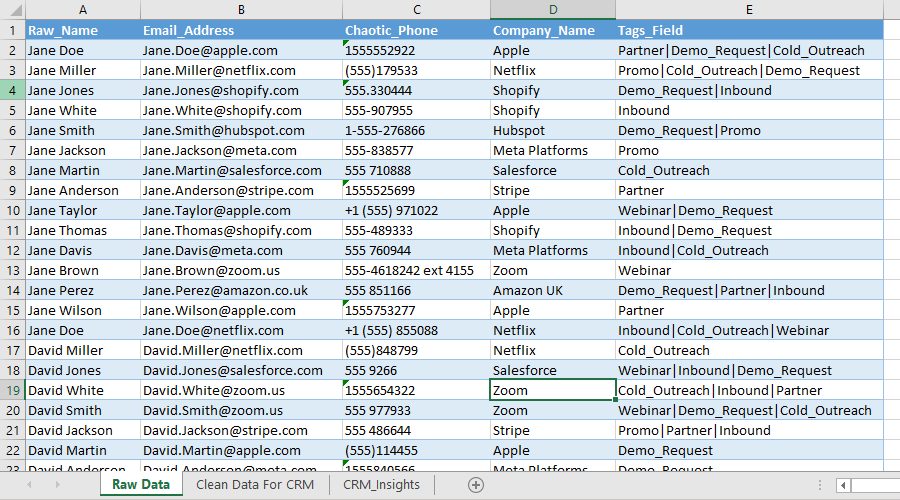
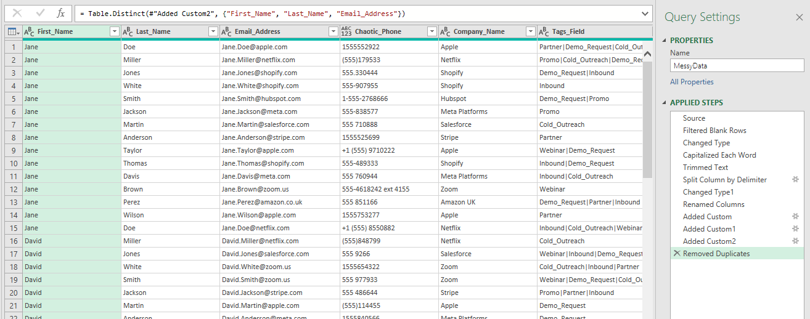
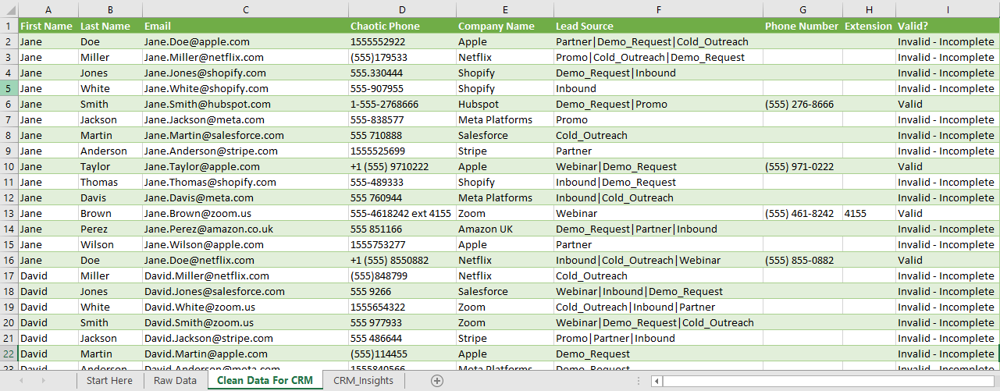
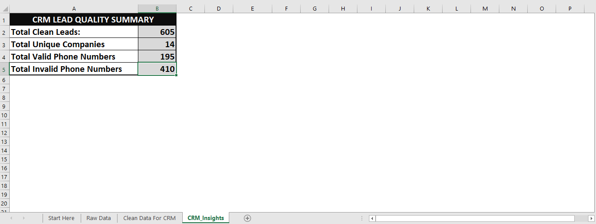

# 📞 B2B CRM Lead Cleaning & Phone Validation Pipeline
### Excel Power Query • One-Click ETL • CRM-Ready Output


> 🎥 **Watch it work in 2 minutes:** Paste new raw data → Data → Refresh All → Clean CRM file + KPIs update automatically.
> 👉 **[Watch Demo on YouTube](https://youtu.be/UeGEInQhmhA)**

---

## ⚡ At a Glance

| Metric | Result |
| :--- | :--- |
| **Raw Input** | 5,000+ messy event leads |
| **Clean Unique Leads** | **605** |
| **Unique Companies** | **14** |
| **Dial-Ready Phones** | **195 Valid** |
| **Flagged / Incomplete** | **410 Invalid** |
| **Time to Clean** | **1 Click** |

> Demo file in this repo uses a 12-row sample of the same dataset, so you can test the refresh instantly.

---

## 🧩 The Business Problem

A B2B marketing team had to import an event export into **HubSpot / Salesforce** before Monday morning. The file was unusable:

- **Messy names:** `john SMITH`, `sarah  jones` in one `Raw_Name` column
- **Chaotic phones:** `+1 (555) 276-8666`, `1-555-4618242 ext 4155`, `1555552922`, `555-907955`
- **Duplicates:** Same person signed up for 3 sessions with different casing/spacing
- **Zero visibility:** No way to tell which numbers were actually dialable

Sales couldn't import it. Marketing couldn't trust it.

---

## ✅ The Solution

A **4-tab, one-click pipeline** built entirely in Excel Power Query:

**`Start Here` → `Raw Data` → `Clean Data For CRM` → `CRM_Insights`**

No VBA. No manual cleaning. Paste → Refresh → Export.

### 1. Raw Messy Input


### 2. Automated Power Query Transformation


### 3. CRM-Ready Output


### 4. Executive KPI Dashboard


---

## 🔧 What The Pipeline Does

| Step | Rule |
| :--- | :--- |
| **1. Clean Names** | Trim whitespace → Proper Case → Split `Raw_Name` into `First Name` / `Last Name` |
| **2. Extract Extension** | Finds `ext` / `x` and moves digits to `Extension` column. `ext 4155` → `4155` |
| **3. Normalize Phone** | Strips `+1` / `1` country code *before* counting digits (prevents false `(155)` area codes) |
| **4. Format (NANP)** | Valid 10-digit numbers → `(555) 276-8666`. Invalid numbers stay blank so CRM never gets bad data |
| **5. Validate** | Flags every row: `Valid`, `Invalid - Incomplete`, `Invalid - Too Long`, `Invalid - Bad Area Code`, `Missing` |
| **6. Deduplicate** | Removes duplicates on `First Name + Last Name + Email` |

### Validation Logic

| Digits After Cleaning | Result |
| :--- | :--- |
| `10` and doesn't start with `0` | ✅ **Valid** |
| `< 10` | ❌ **Invalid - Incomplete** |
| `> 10` | ❌ **Invalid - Too Long** |
| `10` but starts with `0` | ❌ **Invalid - Bad Area Code** |
| Blank | ⚪ **Missing** |

---

## 📊 CRM Insights — Live KPIs

All KPIs recalculate on every Refresh:

```excel
Total Clean Leads     = COUNTA(Clean Table)
Total Unique Companies = COUNTA(UNIQUE(Company Name))
Total Valid Phones    = COUNTIF(Valid?, "Valid")
Total Invalid Phones  = COUNTIF(Valid?, "Invalid*")